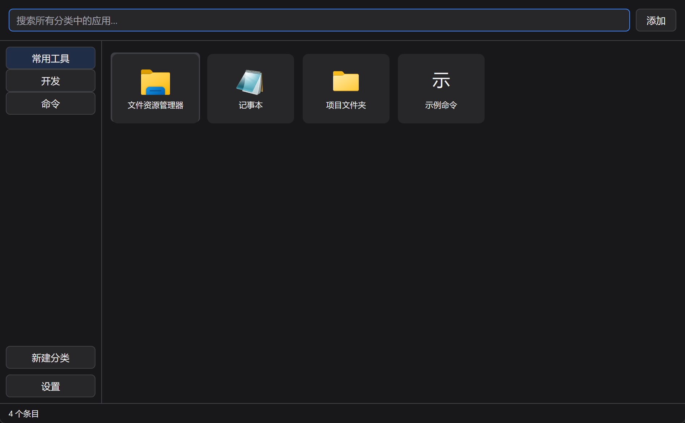
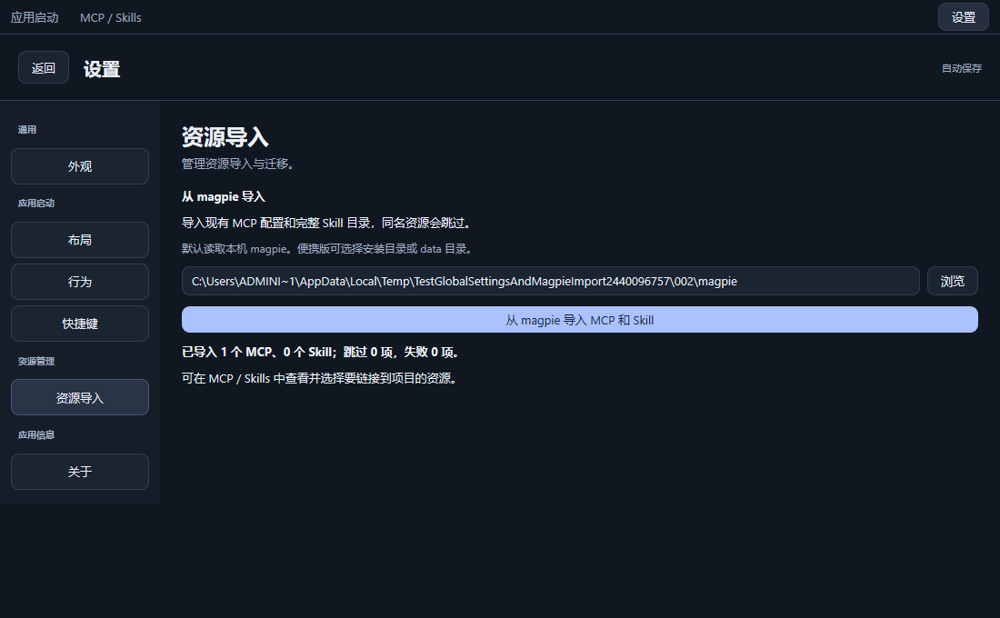
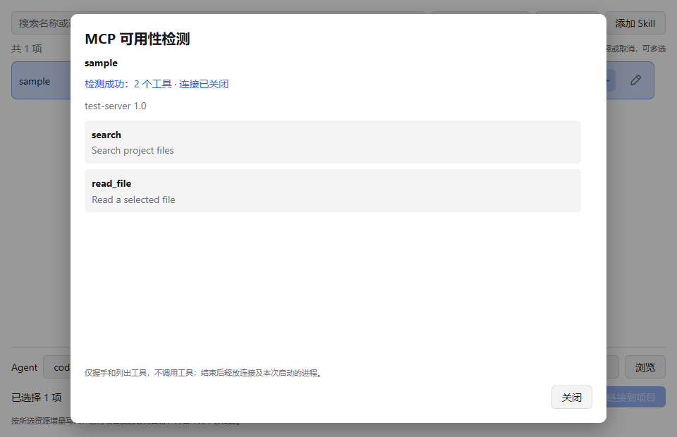
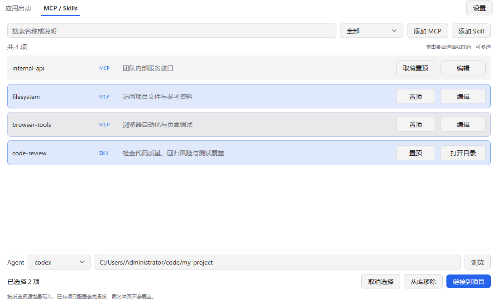

[简体中文](README.zh-CN.md)

# My Quickstart Go

A native desktop launcher for **Windows, macOS, and Linux**, built in Go with [MyGo](https://github.com/egoist/mygo). Organize applications, files, folders, and commands into groups and launch them with a click. The interface uses native Go UI components, without a browser or WebView.



## Features

- **Groups and search:** create, rename, and remove groups; press Ctrl/Cmd+F to search names across all groups. A new query selects the first matching group. The sidebar shows each group's match count and disables groups with no matches; clearing the search restores the previous group.
- **Launch entries:** open applications, files, folders, URLs, and shell commands. Edit names, paths, arguments, and per-entry environment variables. Add files through the context menu or drag them into the window, and browse installed applications using the system application picker.
- **Drag to organize:** insert cards before or after another card, with a live preview as neighboring cards make room. Release to save or press Esc to cancel. Drop a card onto a sidebar group to move it to that group. Reordering is available when search is empty.
- **Five themes:** Graphite, Paper, Midnight, Forest, and Rose. Change the theme immediately from its preview card. Choose English or Simplified Chinese, adjust fonts, and customize card and sidebar dimensions.
- **Desktop integration:** tray controls, a global show/hide shortcut, always-on-top mode, hidden startup, remembered window bounds, and paths relative to the executable. Windows supports `.lnk` resolution and UWP entries; other platforms use their own application lists and launch mechanisms.
- **Local persistence:** SQLite storage with transactional saves, legacy data migration, and protection against replacing unreadable data with an empty state.
- **Scheduled tasks:** run a complete command daily at a chosen time or at Windows startup after sign-in, with enable/disable controls, manual runs, and a searchable paginated list.

Right-click empty space in the card grid to add entries. Right-click empty space in the sidebar to add a group, or right-click a group to rename or remove it. Settings is at the far right of the top tab bar, available from every tab.

Under **Settings → Layout → Feature tabs**, turn **Show MCP / Skills** and **Show scheduled tasks** on or off independently. Turning both off leaves only Launcher, removes the entire tab bar, and moves Settings to the bottom of the group sidebar. Turn them back on to restore the tabs. Preferences persist across restarts; older databases show all tabs by default. Hiding a page keeps its data, and enabled scheduled tasks continue running in the background.

Settings groups **Appearance** under General; **Layout, Behavior, and Hotkey** under Launcher; **Resource import** under Resources; and **About** under Information. About shows the application version, Go version, platform, and the dependency versions embedded in the executable. Wide windows use a scrollable sidebar; narrow windows use a category selector. Changes save automatically, except the global hotkey, which needs **Apply** to validate registration. The entry editor adapts to smaller windows while keeping its save button visible.



More previews: [themes](docs/themes-preview.png), [search](docs/search-preview.png), [entry editor](docs/editor-preview.png), and [drag reordering](docs/drag-preview.png). The previews are rendered with MyGo's headless UI tester and sample data. A detailed feature comparison and validation record is available in [Chinese](docs/FEATURES.md).

## Scheduled tasks

Open **Scheduled tasks → Add task**, enter a name and the complete **Command**, then choose a daily time (24-hour clock) or **Run at startup (after Windows sign-in)**. Examples include `python C:\xx.py` and `"C:\Python env\python.exe" "C:\scripts\daily report.py" --daily`. Quote paths containing spaces. Commands support programs on PATH, batch scripts, and shell operators.

On Windows, **Program window** offers **Hide window** (the default for new tasks), **Show window**, and **Hide console only** (the default for existing tasks). The launcher passes this preference to a directly executed program, or to `cmd.exe` for shell commands such as pipelines. GUI programs can choose to display subsequent windows themselves. **Run now** uses the same preference.

Enabling the first startup task registers the launcher for the current Windows user's sign-in. Each enabled startup task gets one automatic attempt per boot after sign-in. Signing in again during the same boot or opening the launcher manually does not trigger another attempt. Disabling or deleting the last enabled startup task removes the login registration.

New commands use the launcher's directory as their working directory. To switch directories on Windows, use `cd /d "C:\scripts" && python task.py`. Existing tasks preserve their interpreter and working directory when you change their name, trigger or window preference. When the console is hidden, the launcher writes the last 8 KiB of stderr from failed commands to the rotating `logs` directory. With **Show window**, console programs write to their own window.

The list supports name/command search, 20 tasks per page, editing, deletion, enable/disable, and **Run now**. It shows the next scheduled time and latest launch result. A successful result means the operating system accepted the launch, not that the command finished successfully; errors inside a running shell, such as an unknown program, are recorded in the logs. Manual runs also work for disabled tasks and do not replace the day's scheduled run.

Daily tasks use the computer's local clock and continue while the launcher is hidden in the tray. Keep the launcher running: exiting it stops scheduling, and missed minutes during exit or sleep are skipped. Each daily task is automatically attempted at most once per day, including failed launches; the daily claim is saved before starting the program to prevent duplicate attempts after a restart. If this save fails, the program is not launched. Task definitions and their latest results persist in the local SQLite database.

When the hidden-window return delay expires, the app returns to Launcher and resets the scheduled-task view: add/edit/delete dialogs close, unsaved drafts are discarded, and search and pagination reset. Saved tasks and background scheduling continue. Reopening before the deadline preserves the current view. Adjust the delay under **Settings → Behavior**.


## MCP and skill library

The top tabs switch between **Launcher**, **MCP / Skills**, and **Scheduled tasks**, preserving launcher search and group state. The library has search, type filters, and a single scrolling list. Rows are spaced apart and highlight on hover; click anywhere on a row to toggle its selection. Multiple selections persist across searches, with no checkboxes or pagination.

Use **Add MCP** to save a named server with YAML fields `command`, `args`, `env`, `cwd`, or HTTP `url` and `headers`. Use **Add Skill** to import a directory containing `SKILL.md` with `name` and `description` frontmatter. The library references that directory directly without copying files. Deployment reads the current source contents; copies containing nested symlinks are rejected and limited to 100 MiB and 10,000 paths.

Select resources, choose **codex** or **pi**, select a project directory, and click **Copy to project**. Project directories and Skill source directories accept `~` for the current user's home directory, such as `~\code\kernel-debug` or `~/code/kernel-debug`.

MCP names can be edited after saving. Copying a renamed resource again replaces its previously managed name in that project, while preserving other servers. Duplicate resource names remain disallowed.

Use the waveform icon on an MCP row to **Check availability**. The check connects using the saved local command (arguments, environment, working directory) or Streamable HTTP configuration, then lists tool names and descriptions across pages without invoking tools. The dialog shows results or errors. Checks time out after 10 seconds and support cancellation. Completion, failure, or cancellation closes the temporary connection and reaps owned local processes and descendants; HTTP sessions are terminated on a best-effort basis and idle connections are closed. Results are temporary, with no background monitoring. Discovery is capped at 500 tools and 50 pages, with a notice for partial results. Public HTTP endpoints use `http://192.168.1.99:7890`; LAN addresses connect directly. Authentication uses configured credentials only, without an OAuth login flow.



MCP and Skill rows have an **Edit** button. For a Skill, the editor prefills its current directory. Enter or browse to a directory containing `SKILL.md`, then choose **Update and save** to change only the directory reference and refresh the description while preserving its name and pin state. Files in both directories remain unchanged. Invalid sources or failed saves preserve the previous reference; a missing source can be replaced with a new reference. **Open folder** opens the referenced directory in Windows Explorer for manual editing. Copy the resource to each project again to update its independent files. The list's saved name and description are library metadata. MCP configuration comments include concrete `args`, `env`, `cwd`, and HTTP `headers` examples, including on existing entries.

Use **Pin** / **Unpin** on either resource type to keep it at the top. Pin state persists across restarts and MCP edits; multiple pinned resources retain their original relative order. Unpinning restores the resource's place among unpinned entries. Row action buttons do not change selection, and hover/selection highlights keep row sizes fixed.

To migrate existing resources, open **Settings → Resources → Resource import → Import MCPs and skills from magpie**. The default source is `~/.config/magpie` (or `$XDG_CONFIG_HOME/magpie`); portable installations can use the install folder or its `data` folder. Import saves standard stdio/HTTP MCP definitions and notes, and references local skill directories directly, including skills whose root directory is a symlink. Existing same-kind names are skipped, and invalid or unsupported entries are reported individually. SSE and servers with disabled-tool/startup-timeout overrides are reported as unsupported. Magpie's own configuration and files are not changed; agent assignments, OAuth sessions, and plugin runtime state are not migrated. Importing does not deploy resources to a project.



| Agent | MCP configuration file | Skill directory copies |
| --- | --- | --- |
| Codex | `.codex/config.toml` | `.codex/skills/<name>` |
| pi (native MCP) | `.pi/mcp.json` | `.pi/skills/<name>` |

Resource metadata lives in `library` next to the database: `library.yaml` stores resource metadata, MCP definitions, and absolute Skill directory paths. Legacy relative paths under `skills` remain supported and can be changed through the editor. `projects` holds deployment records for each project (legacy generated configs are retained for migration). The library uses YAML; agent configurations use their required TOML or JSON formats.

Deployment writes MCP configuration as a regular project file and copies complete Skill directories. It adds or updates selected entries while preserving other settings and servers. Existing unmanaged configuration files are backed up beside the original as `.quickstart-backup-<id>`. Formatting and comments may change; backups retain the exact original bytes. Same-name Skill directories are moved aside before copying the complete new version, including unmanaged or locally modified directories. Obsolete and project-only files do not survive replacement. Old directories are temporarily stored under the project's `__tmp` and deleted by explicit inventoried paths after success; failed writes restore them and roll back changes. Conflicting MCP names and foreign symlinks still stop deployment. Deployment records include content digests of the copied results. Editing an MCP or Skill requires copying it again to each intended project; project copies remain independent.

Legacy symlinks created by this application are converted to independent copies when those resources are deployed again, preserving the library source. Copying does not require Windows Developer Mode or administrator privileges. Removing a library entry retains deployed configurations and Skill files; it does not uninstall project resources. Both agents require project trust before loading project MCP configuration. Pi uses its current native MCP format, not older extension adapters. Credentials are stored as plain text in the local library and project configuration files.

The library design references [magpie](https://github.com/yetone/magpie); configuration locations follow [Codex MCP](https://developers.openai.com/codex/mcp), [Codex Skills](https://developers.openai.com/codex/skills), and [pi MCP](https://github.com/badlogic/pi-mono/blob/main/packages/coding-agent/docs/mcp.md).

## Download

Download a prebuilt package from the [latest release](https://github.com/xiaozhu1337/my-quickstart-go/releases/latest):

| Platform | x64 / Intel | ARM64 / Apple Silicon |
| --- | --- | --- |
| Windows | [ZIP](https://github.com/xiaozhu1337/my-quickstart-go/releases/latest/download/my-quickstart-go-windows-amd64.zip) | [ZIP](https://github.com/xiaozhu1337/my-quickstart-go/releases/latest/download/my-quickstart-go-windows-arm64.zip) |
| macOS | [TAR.GZ](https://github.com/xiaozhu1337/my-quickstart-go/releases/latest/download/my-quickstart-go-darwin-amd64.tar.gz) | [TAR.GZ](https://github.com/xiaozhu1337/my-quickstart-go/releases/latest/download/my-quickstart-go-darwin-arm64.tar.gz) |
| Linux | [TAR.GZ](https://github.com/xiaozhu1337/my-quickstart-go/releases/latest/download/my-quickstart-go-linux-amd64.tar.gz) | [TAR.GZ](https://github.com/xiaozhu1337/my-quickstart-go/releases/latest/download/my-quickstart-go-linux-arm64.tar.gz) |

Extract the package before running it. Windows packages contain an `.exe`; macOS packages contain an `.app`; Linux packages contain the executable. Unix archives preserve executable permissions. [SHA256SUMS](https://github.com/xiaozhu1337/my-quickstart-go/releases/latest/download/SHA256SUMS) contains checksums for all six packages. See the platform requirements below; macOS builds are unsigned.

## Build and run

The Go toolchain is managed with [mise](https://mise.jdx.dev/) and pinned to **Go 1.27.3**. The UI uses MyGo **v0.9.1**; dependencies are pinned in `go.mod` and `go.sum`. The build script uses only the Python standard library.

```sh
mise install go@1.27.3
mise exec go@1.27.3 -- go run ./cmd/quickstart
```

Build Windows x64 (the only target produced by the build script):

```sh
python -X utf8 "scripts/build.py"
```

The script always builds `windows-amd64` and overwrites `bin/windows-amd64/my-quickstart-go.exe`. The existing `--os windows --arch amd64` arguments remain accepted; other targets are rejected. Keep only `windows-amd64` under `bin`; build outputs are ignored by Git. Run the resulting `.exe` on Windows. The build uses `CGO_ENABLED=0`, while MyGo loads native system libraries at runtime.

Linux requires GTK 3. Tray support also requires `libayatana-appindicator3` and desktop support; Wayland global shortcuts depend on the desktop's GlobalShortcuts portal. Window positioning and always-on-top behavior can also be constrained by Wayland. macOS builds are not signed or notarized.

Windows embeds seven icon sizes in the executable and sets native title-bar and taskbar icons. macOS bundles an ICNS file and sets the Dock icon. Linux uses GTK default and window icons, whose presentation depends on the desktop environment. The shared icon assets are in `internal/branding`.

## Everyday use

- **Ctrl/Cmd+F:** reveal and focus the search field; select an existing query when the field is already open.
- **Esc:** clear and hide search; cancel an active card drag.
- **Click or Enter/Space:** launch an entry. Successful launches leave the launcher visible.
- **Close the window:** hide it to the tray. Use **Quit** in the tray menu to exit and flush pending changes. If neither a tray nor a global shortcut is available, the window stays visible so it can still be reached.

The global hotkey is empty by default. Set a shortcut such as `Ctrl+Alt+Space` in Settings and apply it. A failed registration preserves the previous shortcut.

Hidden startup controls the launcher's initial visibility. To start it at login on Windows, create or update a shortcut in your Windows Startup folder.

Startup preloads the initial screen's icons (up to 128 cards, with a 500 ms wait limit) and prepares content before revealing the window. On Windows, the hidden native surface also draws its first GPU frame without showing or activating the window; shell icons are extracted on background COM threads. Later reveals prepare the current frame before showing it. macOS/Linux warm content layout and text; their desktop backends still initialize GPU presentation when the window is mapped. Very slow or unavailable targets retain their placeholder while icon loading continues.

## Data and legacy migration

| Platform | Default database |
| --- | --- |
| Windows | `%LOCALAPPDATA%/my-quickstart-go/launcher.db` |
| macOS | `~/Library/Application Support/my-quickstart-go/launcher.db` |
| Linux | `$XDG_CONFIG_HOME/my-quickstart-go/launcher.db`, or `~/.config/my-quickstart-go/launcher.db` if unset |

On first launch, if the new default database does not exist, the app looks for the previous Tauri launcher's `my-quickstart/launcher.db` and historical `com.cat.tauri-app/launcher.db`. It searches LocalAppData/AppData on Windows, Application Support on macOS, and XDG_DATA_HOME or `~/.local/share` on Linux.

Migration reads a consistent SQLite snapshot, validates it, and then creates the new database. It preserves groups, order, entry IDs, arguments, environment variables, icons, and settings. An existing new database is never overwritten. Migration does not modify the old DB or WAL contents, although SQLite may update locking or shared-memory metadata.

Relative paths remain relative to the **new executable's directory**. Place the executable accordingly or edit the affected entries. Moving data between operating systems does not convert Windows paths, UWP entries, or command syntax into their equivalents on another platform.

Use `--data "path/to/launcher.db"` to select a separate database. Custom paths do not trigger automatic legacy import. If the old app has only saved data in WebView localStorage, run it once to persist the data to SQLite before migrating.

Entries and settings remain in local SQLite, including environment variable values stored as plain text. Removing an entry does not delete its target. Errors are logged asynchronously to `logs/launcher.log` next to the executable, so that directory must be writable. Logs rotate at 2 MiB and keep the current file plus two backups.

## Testing

UI tests use [MyGo `ui.NewTester`](https://mygo.egoist.dev/docs/ui/testing) to simulate input, clicks, dragging, scrolling, keyboard navigation, and layout **without opening a window**. Drag tests cover 100% and 200% scale.

```sh
mise exec go@1.27.3 -- go test ./...
mise exec go@1.27.3 -- go test -race ./...
mise exec go@1.27.3 -- go vet ./...
```

Windows tests, race checks, and static checks pass. Headless UI and backend tests have also run on Linux through WSL. All six Windows/macOS/Linux architecture combinations build successfully; Windows icon resources and macOS bundle metadata have been checked. Real macOS and Linux desktop interactions remain unverified; see the [validation record](docs/FEATURES.md) for details.

## Project layout

| Directory | Purpose |
| --- | --- |
| `cmd/quickstart` | Application entry point and generated Windows icon resources |
| `internal/launcher` | Native views, interactions, and persistence scheduling |
| `internal/library` | YAML resource storage, skill imports, and transactional agent deployment |
| `internal/libraryui` | MCP / Skills list, editors, selection, and project deployment controls |
| `internal/model` | Launcher state and normalization |
| `internal/store` | SQLite storage and legacy migration |
| `internal/platform` | Platform-specific launching and shortcut handling |
| `internal/branding` | Shared PNG, ICO, and ICNS icon assets |
| `internal/logging` | Asynchronous error logging |
| `scripts` | Build tooling |

Windows icon resource objects are checked in, so normal builds do not need a resource compiler. After replacing the ICO, compile `internal/branding/icon.rc` to a `.res` file with LLVM `windres`, then regenerate the corresponding `.syso` files with `llvm-cvtres /MACHINE:X64` and `/MACHINE:ARM64`.
