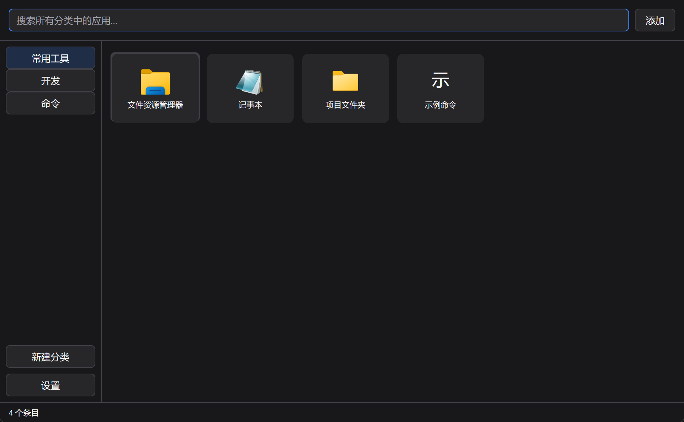
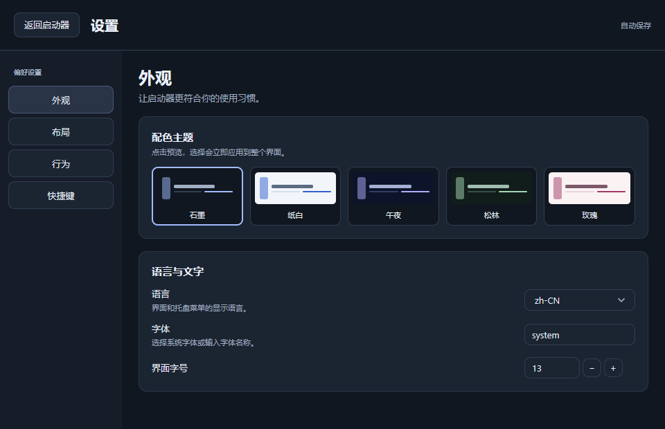

[简体中文](README.zh-CN.md)

# My Quickstart Go

A native desktop launcher for **Windows, macOS, and Linux**, built in Go with [MyGo](https://github.com/egoist/mygo). Organize applications, files, folders, and commands into groups and launch them with a click. The interface uses native Go UI components, without a browser or WebView.



## Features

- **Groups and search:** create, rename, and remove groups; press Ctrl/Cmd+F to search names across all groups. A new query selects the first matching group. The sidebar shows each group's match count and disables groups with no matches; clearing the search restores the previous group.
- **Launch entries:** open applications, files, folders, URLs, and shell commands. Edit names, paths, arguments, and per-entry environment variables. Add files through the context menu or drag them into the window, and browse installed applications using the system application picker.
- **Drag to organize:** insert cards before or after another card, with a live preview as neighboring cards make room. Release to save or press Esc to cancel. Drop a card onto a sidebar group to move it to that group. Reordering is available when search is empty.
- **Five themes:** Graphite, Paper, Midnight, Forest, and Rose. Change the theme immediately from its preview card. Choose English or Simplified Chinese, adjust fonts, and customize card and sidebar dimensions.
- **Desktop integration:** tray controls, a global show/hide shortcut, always-on-top mode, hidden startup, remembered window bounds, and paths relative to the executable. Windows supports `.lnk` resolution and UWP entries; other platforms use their own application lists and launch mechanisms.
- **Local persistence:** SQLite storage with transactional saves, legacy data migration, and protection against replacing unreadable data with an empty state.

Right-click empty space in the card grid to add entries. Right-click empty space in the sidebar to add a group, or right-click a group to rename or remove it. The bottom-left corner contains only Settings.

Settings has four sections: **Appearance, Layout, Behavior, and Hotkey**. Wide windows use a sidebar; narrow windows use tabs. Changes save automatically, except the global hotkey, which needs **Apply** to validate registration. The entry editor adapts to smaller windows while keeping its save button visible.



More previews: [themes](docs/themes-preview.png), [search](docs/search-preview.png), [entry editor](docs/editor-preview.png), and [drag reordering](docs/drag-preview.png). The previews are rendered with MyGo's headless UI tester and sample data. A detailed feature comparison and validation record is available in [Chinese](docs/FEATURES.md).

## Download

Download a prebuilt package from the [latest release](https://github.com/xiaozhu1337/my-quickstart-go/releases/latest):

| Platform | x64 / Intel | ARM64 / Apple Silicon |
| --- | --- | --- |
| Windows | [ZIP](https://github.com/xiaozhu1337/my-quickstart-go/releases/latest/download/my-quickstart-go-windows-amd64.zip) | [ZIP](https://github.com/xiaozhu1337/my-quickstart-go/releases/latest/download/my-quickstart-go-windows-arm64.zip) |
| macOS | [TAR.GZ](https://github.com/xiaozhu1337/my-quickstart-go/releases/latest/download/my-quickstart-go-darwin-amd64.tar.gz) | [TAR.GZ](https://github.com/xiaozhu1337/my-quickstart-go/releases/latest/download/my-quickstart-go-darwin-arm64.tar.gz) |
| Linux | [TAR.GZ](https://github.com/xiaozhu1337/my-quickstart-go/releases/latest/download/my-quickstart-go-linux-amd64.tar.gz) | [TAR.GZ](https://github.com/xiaozhu1337/my-quickstart-go/releases/latest/download/my-quickstart-go-linux-arm64.tar.gz) |

Extract the package before running it. Windows packages contain an `.exe`; macOS packages contain an `.app`; Linux packages contain the executable. Unix archives preserve executable permissions. [SHA256SUMS](https://github.com/xiaozhu1337/my-quickstart-go/releases/latest/download/SHA256SUMS) contains checksums for all six packages. See the platform requirements below; macOS builds are unsigned.

## Build and run

The Go toolchain is managed with [mise](https://mise.jdx.dev/) and pinned to **Go 1.27.1**. Go dependencies are pinned in `go.mod` and `go.sum`. The build script uses only the Python standard library.

```sh
mise install go@1.27.1
mise exec go@1.27.1 -- go run ./cmd/quickstart
```

Build for your target platform:

```sh
python -X utf8 "scripts/build.py" --os windows --arch amd64
python -X utf8 "scripts/build.py" --os darwin --arch arm64
python -X utf8 "scripts/build.py" --os linux --arch amd64
```

`--os` accepts `windows`, `darwin`, or `linux`; `--arch` accepts `amd64` or `arm64`. Build outputs are placed in the ignored `bin` directory and are not committed to this repository.

| Platform | x64 / Intel | ARM64 / Apple Silicon |
| --- | --- | --- |
| Windows | `bin/windows-amd64/my-quickstart-go.exe` | `bin/windows-arm64/my-quickstart-go.exe` |
| macOS | `bin/darwin-amd64/My Quickstart Go.app` | `bin/darwin-arm64/My Quickstart Go.app` |
| Linux | `bin/linux-amd64/my-quickstart-go` | `bin/linux-arm64/my-quickstart-go` |

On Windows, run the `.exe`; on macOS, open the `.app`; on Linux, run the binary in a desktop session. All targets build with `CGO_ENABLED=0`, while MyGo loads native system libraries at runtime.

Linux requires GTK 3. Tray support also requires `libayatana-appindicator3` and desktop support; Wayland global shortcuts depend on the desktop's GlobalShortcuts portal. Window positioning and always-on-top behavior can also be constrained by Wayland. macOS builds are not signed or notarized.

Windows embeds seven icon sizes in the executable and sets native title-bar and taskbar icons. macOS bundles an ICNS file and sets the Dock icon. Linux uses GTK default and window icons, whose presentation depends on the desktop environment. The shared icon assets are in `internal/branding`.

## Everyday use

- **Ctrl/Cmd+F:** reveal and focus the search field; select an existing query when the field is already open.
- **Esc:** clear and hide search; cancel an active card drag.
- **Click or Enter/Space:** launch an entry. Successful launches leave the launcher visible.
- **Close the window:** hide it to the tray. Use **Quit** in the tray menu to exit and flush pending changes. If neither a tray nor a global shortcut is available, the window stays visible so it can still be reached.

The global hotkey is empty by default. Set a shortcut such as `Ctrl+Alt+Space` in Settings and apply it. A failed registration preserves the previous shortcut.

Hidden startup controls the launcher's initial visibility. To start it at login on Windows, create or update a shortcut in your Windows Startup folder.

## Data and legacy migration

| Platform | Default database |
| --- | --- |
| Windows | `%LOCALAPPDATA%/my-quickstart-go/launcher.db` |
| macOS | `~/Library/Application Support/my-quickstart-go/launcher.db` |
| Linux | `$XDG_CONFIG_HOME/my-quickstart-go/launcher.db`, or `~/.config/my-quickstart-go/launcher.db` if unset |

On first launch, if the new default database does not exist, the app looks for the previous Tauri launcher's `my-quickstart/launcher.db` and historical `com.cat.tauri-app/launcher.db`. It searches LocalAppData/AppData on Windows, Application Support on macOS, and XDG_DATA_HOME or `~/.local/share` on Linux.

Migration reads a consistent SQLite snapshot, validates it, and then creates the new database. It preserves groups, order, entry IDs, arguments, environment variables, icons, and settings. An existing new database is never overwritten. Migration does not modify the old DB or WAL contents, although SQLite may update locking or shared-memory metadata.

Relative paths remain relative to the **new executable's directory**. Place the executable accordingly or edit the affected entries. Moving data between operating systems does not convert Windows paths, UWP entries, or command syntax into their equivalents on another platform.

Use `--data "path/to/launcher.db"` to select a separate database. Custom paths do not trigger automatic legacy import. If the old app has only saved data in WebView localStorage, run it once to persist the data to SQLite before migrating.

Entries and settings remain in local SQLite, including environment variable values stored as plain text. Removing an entry does not delete its target. Errors are logged asynchronously to `logs/launcher.log` next to the executable, so that directory must be writable.

## Testing

UI tests use [MyGo `ui.NewTester`](https://mygo.egoist.dev/docs/ui/testing) to simulate input, clicks, dragging, scrolling, keyboard navigation, and layout **without opening a window**. Drag tests cover 100% and 200% scale.

```sh
mise exec go@1.27.1 -- go test ./...
mise exec go@1.27.1 -- go test -race ./...
mise exec go@1.27.1 -- go vet ./...
```

Windows tests, race checks, and static checks pass. Headless UI and backend tests have also run on Linux through WSL. All six Windows/macOS/Linux architecture combinations build successfully; Windows icon resources and macOS bundle metadata have been checked. Real macOS and Linux desktop interactions remain unverified; see the [validation record](docs/FEATURES.md) for details.

## Project layout

| Directory | Purpose |
| --- | --- |
| `cmd/quickstart` | Application entry point and generated Windows icon resources |
| `internal/launcher` | Native views, interactions, and persistence scheduling |
| `internal/model` | Launcher state and normalization |
| `internal/store` | SQLite storage and legacy migration |
| `internal/platform` | Platform-specific launching and shortcut handling |
| `internal/branding` | Shared PNG, ICO, and ICNS icon assets |
| `internal/logging` | Asynchronous error logging |
| `scripts` | Build tooling |

Windows icon resource objects are checked in, so normal builds do not need a resource compiler. After replacing the ICO, compile `internal/branding/icon.rc` to a `.res` file with LLVM `windres`, then regenerate the corresponding `.syso` files with `llvm-cvtres /MACHINE:X64` and `/MACHINE:ARM64`.
