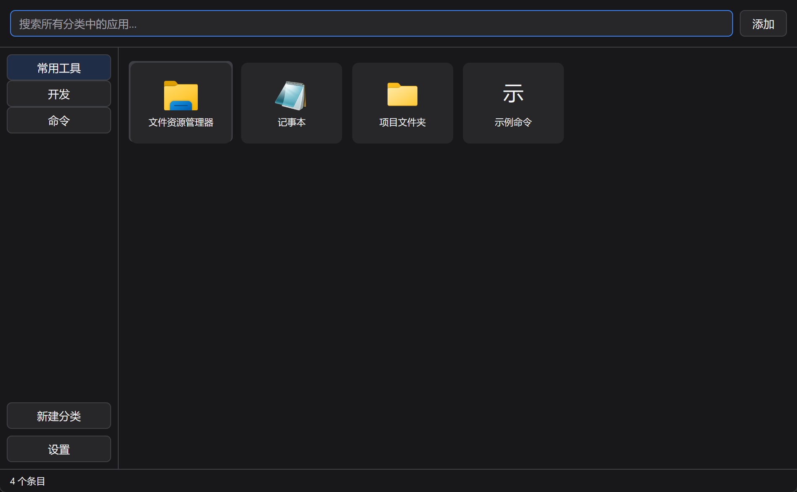
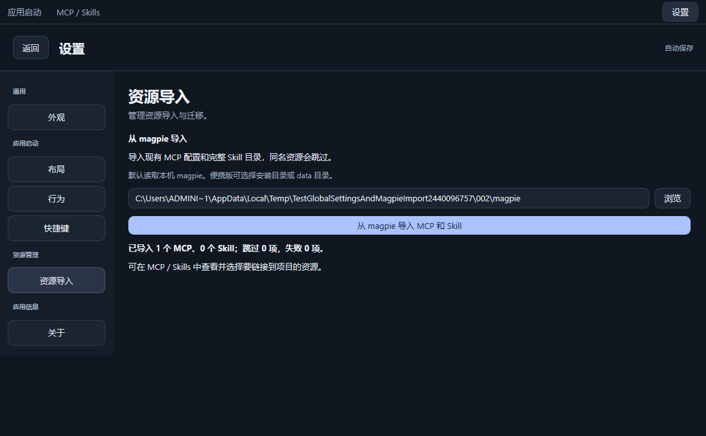
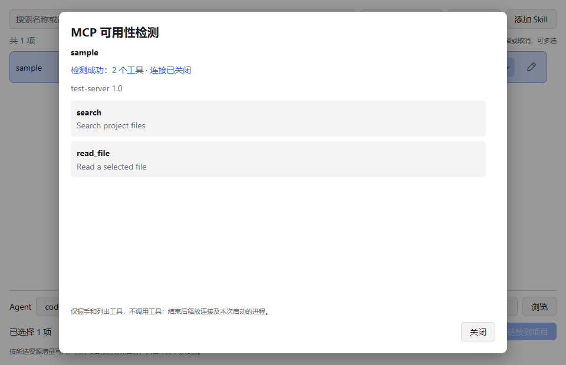
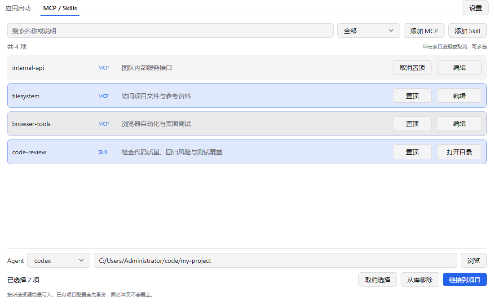

[English](README.md)

# My Quickstart Go

使用 [MyGo](https://github.com/egoist/mygo) 原生 Go 组件重构的桌面快速启动器，支持 Windows、macOS 和 Linux。界面采用按快捷键展开的搜索栏、分类侧栏、卡片网格和原生弹层；不依赖 Tauri、浏览器或 WebView。



支持分类增删改、跨分类名称搜索、应用/文件/目录启动、命令、参数和逐项环境变量、系统应用选择、文件拖入、卡片排序和跨分类移动。保留中英文、字体、卡片与侧栏尺寸、窗口置顶、启动时隐藏、相对路径、窗口位置记忆、全局快捷键和托盘。完整对照及平台差异见 [功能与验证记录](docs/FEATURES.md)。

界面提供 **石墨、纸白、午夜、松林、玫瑰** 五种主题，覆盖深浅配色；在设置中点击主题预览即可即时应用并自动保存，系统标题栏同步切换深浅样式。主界面以分类和应用网格组织内容；搜索栏默认收起，Ctrl/Cmd+F 显示并聚焦，Esc 清空并收起。搜索时自动选中首个匹配分类，仅显示当前分类的匹配条目；侧栏显示各分类匹配数量，零匹配分类变灰且不可选，清空搜索恢复之前的分类。提示栏仅在有消息时出现。通过网格空白处的右键菜单添加应用、文件或命令，Windows 的应用选择入口为“添加 UWP 应用”。应用编辑弹窗宽度为 720 DIP，小窗口自动收窄，表单可滚动且保存按钮保持可见。

未搜索时，拖动卡片可插入到其他卡片前后，周围卡片实时让位并显示占位；松手后保存顺序，Esc 取消。也可拖到侧栏分类，移入该组首位，见 [拖动预览](docs/drag-preview.png)。

设置采用独立页面，按 **通用（外观）、应用启动（布局、行为、快捷键）、资源管理（资源导入）、应用信息（关于）** 分类。“关于”显示程序版本、Go 版本、运行平台，以及可执行文件实际包含的依赖库版本。常规窗口使用可滚动的左侧导航，窄窗口改用分类下拉框；尺寸设置提供卡片预览。除全局快捷键需要点击“应用”验证注册结果外，其他设置自动保存。

设置入口位于顶部标签栏最右侧，在应用启动和 MCP / Skills 页都可打开；返回时保留原来所在页面。在分类侧栏空白处右键选择“添加分类”，分类自身的右键菜单可重命名、移除。窗口、托盘和应用文件统一使用蓝色四格图标：Windows 标题栏与任务栏设置原生图标，exe 内嵌七档尺寸资源，macOS 应用包提供 ICNS 并设置 Dock 图标。Linux 通过 GTK 设置默认及窗口图标，显示位置由桌面环境决定。



搜索与编辑器预览：[搜索匹配与灰色分类](docs/search-preview.png)、[加宽应用编辑框](docs/editor-preview.png)。

五种主题见 [主题对照图](docs/themes-preview.png)。以上预览使用 MyGo 原生界面测试器与示例数据渲染。

## MCP 与 Skill 资源库

顶部提供“应用启动”和“MCP / Skills”两个标签，切换时保留启动器的搜索与分类状态。资源库使用单页滚动列表，支持名称/说明搜索和类型筛选。条目之间留有间距，鼠标悬停高亮，左键点击整行可选择或取消选择；支持多选，搜索时保留已有选择，无复选框和分页按钮。

1. 点击“添加 MCP”，填写名称、说明和单个服务的 YAML 配置。支持 `command`、`args`、`env`、`cwd`，或 HTTP 的 `url`、`headers`；可再次编辑配置。
2. 点击“添加 Skill”，选择含 `SKILL.md` 的目录。文件须包含 `name` 和 `description` frontmatter；直接将该目录记录为 Skill 所在目录，不复制文件。复制到项目时才读取当前目录内容；复制时拒绝目录内的软链接，单项上限为 100 MiB、10000 个路径。
3. 左键点击所需 MCP / Skill 条目，选择 `codex` 或 `pi`、项目目录，再点击“复制到项目”。项目目录和添加、编辑 Skill 的目录均支持 `~` 表示当前用户主目录，例如 `~\code\kernel-debug` 或 `~/code/kernel-debug`。

MCP 保存后可随时编辑名称；再次复制到项目时，会替换这个资源先前使用的名称，保留其他服务。同类型资源仍不能重名。

点击 MCP 行右侧的波形图标可“检测可用性”：使用已保存的本地命令（含参数、环境变量、工作目录）或 Streamable HTTP 配置进行握手，并分页读取工具名称与说明。弹窗显示检测结果、工具列表或失败原因，不执行工具。检测限时 10 秒，可取消；完成、失败、取消后均关闭临时连接，本次启动的本地进程及子进程会回收，HTTP 会话会尝试终止，并关闭空闲连接。结果只保留在当前弹窗中，不持续监控。最多展示 500 个工具、读取 50 页，达到限制时明确提示。HTTP 公网请求使用代理 `http://192.168.1.99:7890`，局域网地址直接连接；仅使用配置中的认证信息，不执行 OAuth 登录。



MCP 和 Skill 条目均提供“编辑”按钮。编辑 Skill 时，输入框预填当前目录；填写或选择新的含 `SKILL.md` 的目录后，点击“更新并保存”，只修改目录引用并刷新说明，保留当前名称与置顶状态，不修改新旧目录中的文件。目录无效或保存失败时保留原引用；原目录已丢失时也可重新指定。Skill 的“打开目录”按钮通过 Windows 资源管理器打开当前引用的目录，也可自行编辑 `SKILL.md` 和附带文件。修改后需再次复制到项目，已部署副本不会自动变化。列表中的名称和说明仍使用资源库保存的元数据。MCP 配置注释提供 `args`、`env`、`cwd` 和 HTTP `headers` 的具体示例，编辑已有条目时也会显示。

两种资源均支持“置顶 / 取消置顶”。置顶状态自动保存，重启和编辑 MCP 后仍保留；多个置顶条目保持原有相对顺序，取消置顶后恢复到普通条目中的原有顺序。点击行内按钮不会改变选择，悬停和选中高亮保持固定行尺寸。

迁移已有资源可进入 **设置 → 资源管理 → 资源导入 → 从 magpie 导入 MCP 和 Skill**。默认读取 `~/.config/magpie`（设置了 `XDG_CONFIG_HOME` 时读取其下的 `magpie`）；便携版可选择安装目录或 `data` 目录。导入会保存标准 stdio/HTTP MCP 配置、备注，并直接引用本地 Skill 目录，也支持 Skill 根目录本身是软链接。同类型同名条目跳过，缺失或不兼容的条目逐项显示原因；SSE、带禁用工具或启动超时覆盖的服务暂不支持导入。不会修改 magpie 原始文件；agent 分配、OAuth 登录态、插件运行状态不随资源迁移。导入后仍需在列表中选择资源并复制到目标项目。



| Agent | MCP 配置文件 | Skill 目录副本 |
| --- | --- | --- |
| Codex | `.codex/config.toml` | `.agents/skills/<name>` |
| pi（原生 MCP） | `.pi/mcp.json` | `.pi/skills/<name>` |

资源元数据保存在数据库同级的 `library` 目录：`library.yaml` 保存资源信息、MCP 配置和 Skill 目录的绝对路径；旧版 `skills` 中的相对路径记录继续兼容，可通过编辑重新指定来源。`projects` 保存每个项目的部署记录（旧版生成配置保留以兼容迁移）。库配置采用 YAML；写入 agent 时转换为其要求的 TOML / JSON。

部署将 MCP 配置写为项目内的普通文件，并把 Skill 完整复制为普通目录；按所选条目增量合并，保留未选中的服务及其他配置。第一次接管已有普通配置文件时，原文件完整备份到旁边的 `.quickstart-backup-<id>`；配置可能重新排版并移除原注释。同名 Skill 会先移走旧目录再完整复制新版，无论旧目录是否由本程序部署、是否被修改；旧版文件和项目内新增文件都不会残留。旧目录暂存于项目的 `__tmp`，成功后按明确路径逐项删除，写入失败则恢复旧目录并回滚本次改动。不同配置的同名 MCP 或其他工具创建的链接仍会导致部署停止。部署记录保存内容摘要，用于记录复制结果。编辑资源库内 MCP 或 Skill 后，需再次复制到需要更新的项目，各项目互不影响。

旧版由本程序创建的 MCP / Skill 软链接，会在再次部署对应条目时转换为独立副本，资源库源文件保留。复制不需要 Windows 开发者模式或管理员权限。Codex 与 pi 都需要信任项目后才加载项目 MCP 配置；pi 按当前原生 MCP 格式接入，不配置旧版扩展适配器。凭据以明文存放在本地库及项目配置中。从列表移除条目会保留已部署配置和 Skill 文件；不会自动从项目卸载。

实现参考 [magpie 资源库](https://github.com/yetone/magpie)，路径与配置格式按 [Codex MCP 文档](https://developers.openai.com/codex/mcp)、[Codex Skills 文档](https://developers.openai.com/codex/skills) 和 [pi MCP 文档](https://github.com/badlogic/pi-mono/blob/main/packages/coding-agent/docs/mcp.md) 核对。

## 直接运行

从 [最新 Release](https://github.com/xiaozhu1337/my-quickstart-go/releases/latest) 下载对应系统和架构的预编译程序，无需安装 Go：

| 平台 | x64 / Intel | ARM64 / Apple Silicon |
| --- | --- | --- |
| Windows | [ZIP](https://github.com/xiaozhu1337/my-quickstart-go/releases/latest/download/my-quickstart-go-windows-amd64.zip) | [ZIP](https://github.com/xiaozhu1337/my-quickstart-go/releases/latest/download/my-quickstart-go-windows-arm64.zip) |
| macOS | [TAR.GZ](https://github.com/xiaozhu1337/my-quickstart-go/releases/latest/download/my-quickstart-go-darwin-amd64.tar.gz) | [TAR.GZ](https://github.com/xiaozhu1337/my-quickstart-go/releases/latest/download/my-quickstart-go-darwin-arm64.tar.gz) |
| Linux | [TAR.GZ](https://github.com/xiaozhu1337/my-quickstart-go/releases/latest/download/my-quickstart-go-linux-amd64.tar.gz) | [TAR.GZ](https://github.com/xiaozhu1337/my-quickstart-go/releases/latest/download/my-quickstart-go-linux-arm64.tar.gz) |

先解压再运行：Windows 包内为 exe，macOS 包内为 `.app`，Linux 包内为可执行文件；Unix 压缩包保留执行权限。[SHA256SUMS](https://github.com/xiaozhu1337/my-quickstart-go/releases/latest/download/SHA256SUMS) 提供六个压缩包的 SHA-256 校验值。

Windows 双击 exe；macOS 通过 Finder 打开 `.app`；Linux 在桌面会话中运行二进制。Linux 需要 GTK 3，托盘需要 `libayatana-appindicator3`；Wayland 全局热键取决于桌面的 GlobalShortcuts portal。macOS 构建尚未签名或公证，需要按本机的应用安全设置放行。

普通关闭会隐藏到托盘；从托盘菜单选择“退出”才结束进程，并在退出前同步保存。没有可用托盘和全局热键时，窗口保持显示，避免失去召回入口。全局热键初始为空，可在设置中输入 `Ctrl+Alt+Space` 并应用。Ctrl/Cmd+F 展开并聚焦主搜索，Esc 清空并收起。

用户原先通过 Windows 启动目录快捷方式实现的开机启动，可将该快捷方式目标改为新版 exe；“启动时隐藏窗口”继续生效。

启动时提前读取首屏图标（最多 128 张，等待上限 500 毫秒），并在显示前准备界面。Windows 会在窗口仍隐藏时完成真实 GPU 首帧，不闪现窗口或抢焦点；系统图标在后台 COM 线程提取。之后每次唤出也先准备当前帧。macOS/Linux 预热布局和文字，GPU 呈现仍由桌面后端在窗口映射时初始化。极慢或不可用目标会保留占位图标并继续后台加载，避免阻止窗口使用。

## 数据与旧版迁移

| 平台 | 新版默认数据库 |
| --- | --- |
| Windows | `%LOCALAPPDATA%/my-quickstart-go/launcher.db` |
| macOS | `~/Library/Application Support/my-quickstart-go/launcher.db` |
| Linux | `$XDG_CONFIG_HOME/my-quickstart-go/launcher.db`，未设时为 `~/.config/my-quickstart-go/launcher.db` |

首次启动且新版默认数据库不存在时，自动查找旧版 `my-quickstart/launcher.db` 及历史 `com.cat.tauri-app/launcher.db`。Windows 查 LocalAppData / AppData，macOS 查 Application Support，Linux 查 XDG_DATA_HOME / `~/.local/share`。读取旧库使用 SQLite 只读一致性事务，完整校验后才创建新版库；不覆盖已有新版数据库，导入失败会明确提示。迁移不写旧 DB/WAL 内容，SQLite 必要的锁及 SHM 元数据可能变化。

旧库中的分类、顺序、条目 ID、参数、环境变量、图标及设置会迁移。相对路径继续相对于**新版程序所在目录**；若原来依靠相对路径，请将新版放到合适目录，或在条目编辑器中调整路径。跨系统迁移不会把 Windows 路径、UWP 或命令语法自动转换成其他系统的等价内容。

可用 `--data "数据库完整路径"` 指定独立数据库。自定义路径不自动导入旧库；该选项也便于使用数据副本验证。加载错误不会被默认数据覆盖。旧版若仅在 WebView localStorage 中保存过数据，请先运行旧版让其写入 SQLite，再启动新版。

错误异步写入程序所在目录的 `logs/launcher.log`，该目录必须可写；单文件上限 2 MiB，保留当前日志和两份轮换日志。启动器设置和条目继续保存在 SQLite 中，兼容旧表结构；MCP / Skill 使用独立的 `library` 目录。

## 开发与构建

Go 工具链通过 [mise](https://mise.jdx.dev/) 管理，版本固定为 1.27.3；MyGo 和 SQLite 依赖由 `go.mod` / `go.sum` 锁定。构建脚本仅使用 Python 标准库。

界面回归使用 [MyGo `ui.NewTester`](https://mygo.egoist.dev/docs/ui/testing)，不打开窗口，在内存中模拟输入、点击、拖动、滚动、键盘与布局；拖拽测试覆盖 100% / 200% 缩放。运行下面的 `go test` 不会弹出应用窗口。

```sh
mise install go@1.27.3
mise exec go@1.27.3 -- go run ./cmd/quickstart
mise exec go@1.27.3 -- go test ./...
mise exec go@1.27.3 -- go test -race ./...
mise exec go@1.27.3 -- go vet ./...
```

```sh
python -X utf8 "scripts/build.py"
```

构建脚本固定只生成 `windows-amd64`，每次覆盖 `bin/windows-amd64/my-quickstart-go.exe`；`bin` 下只保留此构建目录。原来的 `--os windows --arch amd64` 参数仍可使用，其他目标会被拒绝。图标源文件位于 `internal/branding`；Windows x64 图标资源已预生成到 `cmd/quickstart/icon_windows_amd64.syso`，正常构建不需要资源编译器。更换 ICO 时，可用 LLVM 的 `windres` 编译 `internal/branding/icon.rc` 为 `.res`，再用 `llvm-cvtres /MACHINE:X64` 更新对应 `.syso`。构建使用 `CGO_ENABLED=0`，运行时使用 MyGo 的原生系统接口。

源代码：`cmd/quickstart` 为入口，`internal/launcher` 为原生界面及交互，`internal/model` 为状态，`internal/store` 为 SQLite 和迁移，`internal/platform` 为平台启动及快捷方式，`internal/logging` 为异步日志。
